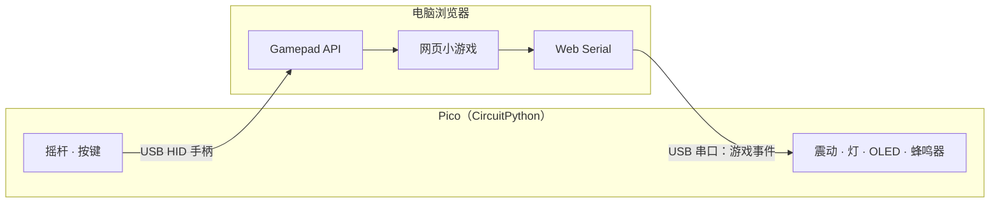

# Pico Pad

用 Raspberry Pi Pico 自己做一个 USB 游戏手柄，再写一个网页小游戏用它来玩。手柄不只是输入：游戏会把"漏接了""得分了"这类事件发回手柄，让它震动、亮灯、显示分数。

A DIY USB gamepad built on a Raspberry Pi Pico, plus a browser game that talks back to it: the Pico is a plain HID gamepad for input, and a USB serial channel carries game events back for rumble, lights and a score display. [English summary below](#english).

> 状态：**M1 读硬件**。路线图见 [docs/BACKLOG.md](docs/BACKLOG.md)。

## 架构



同一根 USB 线上走两个通道：

- **HID 手柄**：即插即用，不用装驱动，电脑和别的游戏也都认。
- **USB 串口**：一行一条文本指令，比如 `V 200` 震动 200 毫秒。协议见 [docs/protocol.md](docs/protocol.md)。

## 快速开始（M1）

1. 按 [hardware/README.md](hardware/README.md) 在面包板上接好摇杆和按键（摇杆接 **3V3**，不要接 5V）。
2. 按 [firmware/README.md](firmware/README.md) 给 Pico 刷 CircuitPython。
3. 复制固件：
   ```bash
   cd firmware
   chmod +x deploy.sh
   ./deploy.sh
   ```
4. 打开串口（Thonny / Mu / `screen`），推摇杆、按按键，应该能看到实时读数。

到 M3 以后，用浏览器打开 [`game/tester.html`](game/tester.html) 就能看到手柄的轴和按键。现在用任何别的手柄也可以先试这个页面。

## 目录

```
pico-pad/
├── firmware/        CircuitPython 固件
│   ├── config.py    引脚和参数
│   ├── code.py      主程序
│   ├── deploy.sh    复制到 CIRCUITPY 盘
│   └── requirements.txt
├── game/            网页端
│   └── tester.html  手柄测试页（Gamepad API）
├── hardware/        零件清单、引脚表、电路
└── docs/
    ├── BACKLOG.md   路线图（M0–M7）
    └── protocol.md  串口协议
```

## 路线图

| 阶段 | 内容 | 状态 |
|---|---|---|
| M0 | 刷 CircuitPython | |
| M1 | 读摇杆和按键（校准、死区、消抖） | 进行中 |
| M2 | 当 USB 键盘用 | |
| M3 | 当 USB 手柄用（自定义 HID 描述符） | |
| M4 | 网页游戏"接珍珠" | |
| M5 | 反馈回路：震动、灯、OLED | |
| M6 | 焊接、外壳 | |
| M7 | 接线图、演示、写设计取舍 | |

细节和验收标准在 [docs/BACKLOG.md](docs/BACKLOG.md)。

## 技术选择

| 部分 | 用什么 | 为什么 |
|---|---|---|
| 固件 | CircuitPython | 自带 `usb_hid`、`usb_cdc`、`keypad`，改完保存就跑 |
| 输入 | USB HID 手柄 | 不用驱动，什么游戏都能用 |
| 反馈 | USB 串口 + Web Serial | 文本协议简单，好调试 |
| 游戏 | 原生 JS + Canvas | 不用构建工具，GitHub Pages 直接发布 |

<a id="english"></a>
## English

**Pico Pad** is a hardware + software project: a Raspberry Pi Pico running CircuitPython acts as a standard USB HID gamepad, and a small browser game reads it through the Gamepad API. The game sends events back over a second USB serial channel (Web Serial), so the controller can rumble, light up remaining lives, and show the score on an OLED.

- Hardware, BOM and pinout: [hardware/README.md](hardware/README.md)
- Firmware setup: [firmware/README.md](firmware/README.md)
- Serial protocol: [docs/protocol.md](docs/protocol.md)
- Roadmap: [docs/BACKLOG.md](docs/BACKLOG.md)

Current milestone: M1, reading the joystick and buttons with center calibration, deadzone and debouncing.

## License

[MIT](LICENSE)
